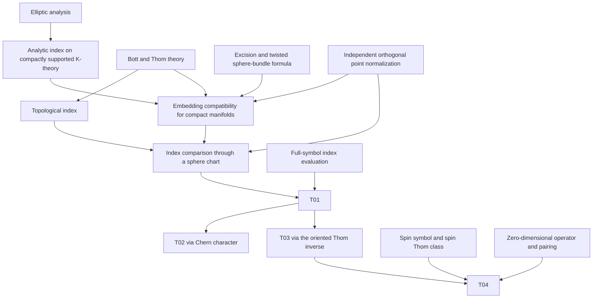

# Formalizing the Atiyah–Singer index theorem in Lean

This report outlines the mathematical specification, proof architecture, development method,
and engineering experience of a formalization of established index theory. It claims no new
mathematical theorem. AI assisted the work; human maintainers retain responsibility for the
specification, source interpretation, implementation, and assessment of the results.

## 1. Theorem objectives

Let $`X`$ be a compact Hausdorff second-countable smooth manifold without boundary,
with $`n=\dim X`$, and let $`P`$ be an elliptic complex pseudodifferential operator of
real order between finite-rank smooth complex bundles. Write $`\mathrm{ind}_a(P)`$,
also denoted $`\mathrm{ind}\,P`$, for its analytic index on smooth sections.
Elliptic analysis establishes that its kernel
and cokernel are finite-dimensional and compares this index with Sobolev realizations.

Let $`u=[\sigma_{\mathrm{full}}(P)]\in K_c^0(T^*X)`$ be its intrinsic full-symbol class,
and let $`u_T\in K_c^0(TX)`$ be the class transported by the chosen metric identification.
The cohomological pairings below use rational coefficients and evaluate the appropriate
top-degree components.

The four main formulations follow SG Chapter III, Section 13:

**T01 — Analytic and topological indices.** For arbitrary real operator order,

$$
\mathrm{ind}_a(P) = \mathrm{ind}_t(u).
$$

The differential-operator version is also provided. In the general full-symbol formulation,
radial freezing and factorization connect the symbol class with the classical K-theory
argument.

**T02 — Cohomological formula on the tangent bundle.** With $`\pi:TX\to X`$,

$$
\mathrm{ind}\\,P = (-1)^n \left\langle
  \mathrm{ch}(u_T) \smile \pi^* \widehat{A}(TX)^2,
  [TX]_{\mathrm{lf}}
\right\rangle.
$$

The pairing uses compactly supported cohomology and locally finite homology. The tangent
total space has its canonical interleaved complex orientation; the base need not be orientable.

**T03 — Oriented-base cohomological formula.** For a given integral orientation $`O`$,

$$
\mathrm{ind}\\,P = (-1)^{n(n+1)/2} \left\langle
  \pi_{!} \mathrm{ch}(u_T) \smile \widehat{A}(TX)^2,
  [X]_O
\right\rangle.
$$

The same orientation determines the fundamental class and the inverse Thom map $`\pi_!`$.
Here $`\pi_!`$ inverts $`a\mapsto\pi^*a\smile U_O`$, where $`U_O`$ is the Thom class
induced by $`O`$ on the tangent bundle. The sign combines $`(-1)^n`$ from T02 with
$`(-1)^{n(n-1)/2}`$ from the permutation of interleaved complex directions into the order
with all base directions before fiber directions.

**T04 — Twisted spin Dirac index.** On a compact Riemannian spin manifold of dimension
$`2m`$, for a smooth finite-rank complex coefficient bundle $`W`$ and any smooth complex
connection on $`W`$,

$$
\mathrm{ind}\\,D_W^+ = \left\langle
  \mathrm{ch}(W) \smile \widehat{A}(TX), [X]
\right\rangle.
$$

Here $`[X]`$ uses the supplied spin orientation. The dimension-zero case uses the
positive empty-frame orientation and identifies $`D_W^+`$ with the zero map
$`\Gamma^\infty(W)\to0`$.

The construction uses the associated half-spinor bundles and SG chirality convention.
The arbitrary-connection formulation is justified by invariance of the principal symbol
under changes of the coefficient connection.

T01–T03 have both locally varying finite-rank atlas presentations and native fixed-rank
bundle presentations. The native versions retain the supplied smooth positive density.

| Target | Principal production source | Literature locator |
| --- | --- | --- |
| T01 | `AtiyahSinger/Analysis/FullSymbolIndexTheorem.lean` | SG III.13.2, p.244 |
| T02 | `AtiyahSinger/Analysis/FullSymbolCohomologicalIndexTheorem.lean` | First SG III.13.8, (13.18), pp.254–255 |
| T03 | `AtiyahSinger/Analysis/FullSymbolCohomologicalIndexTheorem.lean` | Second SG III.13.8, (13.24), pp.255–256 |
| T04 | `AtiyahSinger/Analysis/EvenDimensionalTwistedSpinIndex.lean` | SG III.13.10, (13.26), pp.256–257 |

The Comparator harness is configured to check seven propositions: atlas and native
versions of T01–T03, and the uniform native even-dimensional T04. Its configuration
permits no definition holes and only `propext`, `Classical.choice`, and `Quot.sound`.

## 2. Main proof route

The construction follows the embedding and K-theory route in SG Chapter III, Section 13:

1. **Establish the analytic index.** Sobolev spaces, symbol calculus, parametrices, Rellich
   compactness, and elliptic regularity prove Fredholmness and identify the specified smooth
   and Sobolev kernels and cokernels.
2. **Pass to compactly supported K-theory.** Construct elliptic representatives of classes
   in $`K_c^0(T^*X)`$ and prove stabilization, homotopy, and operator-order invariance.
   These comparisons make the analytic index independent of the representative.
   Componentwise assembly gives the index homomorphism for the stated manifold and
   bundle scope.
3. **Construct the topological index independently.** Complex Thom isomorphisms and open
   extension define tangent-bundle pushforwards for proper smooth embeddings. A Euclidean
   embedding and the positive Bott coordinate define the topological index. Independence
   of the embedding and the metric identification supply its cotangent formulation.
4. **Prove embedding compatibility for compact manifolds.** Excision reduces the comparison
   to the normal neighborhood and its associated sphere compactification. The twisted
   sphere-bundle formula retains the full representation-valued fiber index and its
   associated coefficient class. Independent orthogonal point normalization then gives
   compatibility of the analytic index with the geometric pushforward.
5. **Compare through a sphere chart.** Compose a Euclidean embedding with the normalized
   open chart in a sphere, so that the compact-target embedding theorem applies.
   Classes extended from this chart are evaluated by their positive Bott coordinate.
   This proves equality of the analytic and topological index homomorphisms; evaluation
   on the intrinsic full-symbol class gives T01.
6. **Derive the cohomological and spin formulations.** Chern-character compatibility with
   Thom maps, including its characteristic-class correction and orientation signs, gives
   T02 and T03. The transported twisted Dirac symbol is the spin Thom class twisted by
   the coefficient bundle. Substitution into T03, with the spinor character and orientation
   signs, gives T04 in positive even dimensions. Its zero-dimensional case follows from
   the zero map on smooth sections and the corresponding fundamental-class pairing.

The following diagram is schematic; the dependency files specify the detailed prerequisites.

The representation-ring normalization requires a separate argument. For positive-dimensional
orthogonal spheres, the action on top cohomology is the determinant character. If $`\delta`$
denotes its representation class, then $`(1-\delta)(1+\delta)=0`$, so the cancellation of
$`1-\delta`$ in the calculation on SG p.253 requires additional justification. The proof
uses independent low-dimensional calculations, dimension augmentation, external products,
and representation restriction to determine the full orthogonal coefficient. The source
references are ASI, Lemmas 2.8, 3.2, and 4.7, Proposition 4.4, and §§8–9 of that paper.
This normalization supplies an input to the index comparison.

## 3. Reference selection

References were selected to match the constructions, hypotheses, support conditions,
maps, and sign conventions of the formal statements. Literature locators in this report
use printed page numbers.

- **SG:** H. B. Lawson, Jr., and M.-L. Michelsohn. *Spin Geometry*.
  Princeton Mathematical Series, vol. 38. Princeton University Press, Princeton, NJ, 1989.
  [DOI](https://doi.org/10.1515/9781400883912).
- **TA:** M. E. Taylor. *Pseudodifferential Operators*. Princeton Mathematical Series,
  vol. 34. Princeton University Press, Princeton, NJ, 1981.
  [DOI](https://doi.org/10.1515/9781400886104).
- **KA:** M. Karoubi. *K-Theory: An Introduction*. Grundlehren der mathematischen
  Wissenschaften, vol. 226. Springer-Verlag, Berlin, 1978.
  [DOI](https://doi.org/10.1007/978-3-540-79890-3).
- **MS:** J. W. Milnor and J. D. Stasheff. *Characteristic Classes*.
  Annals of Mathematics Studies, vol. 76. Princeton University Press, Princeton, NJ, 1974.
  [DOI](https://doi.org/10.1515/9781400881826).
- **HU:** D. Husemoller. *Fibre Bundles*. 3rd ed. Graduate Texts in Mathematics, vol. 20.
  Springer-Verlag, New York, 1994.
  [DOI](https://doi.org/10.1007/978-1-4757-2261-1).
- **ASI:** M. F. Atiyah and I. M. Singer. “The Index of Elliptic Operators: I.”
  *Annals of Mathematics*, Second Series, **87**(3) (1968), 484–530.
  [DOI](https://doi.org/10.2307/1970715).
- **ASIII:** M. F. Atiyah and I. M. Singer. “The Index of Elliptic Operators: III.”
  *Annals of Mathematics*, Second Series, **87**(3) (1968), 546–604.
  [DOI](https://doi.org/10.2307/1970717).

| Reference | Role in the construction |
| --- | --- |
| SG | Main embedding proof, elliptic analysis, characteristic-class formulas, and spinor constructions; Chapter III §13 and Appendix C |
| TA | Pseudodifferential calculus, parametrices, symbol estimates, and spectral powers |
| KA | Independent Bott argument in III.1 and complex Thom theory in IV.1 |
| MS | Thom and Euler classes, Chern and Pontryagin classes, and multiplicative sequences |
| HU | Vector, principal, and associated bundle foundations |
| ASI | Embedding, product, excision, and independent orthogonal point normalization |
| ASIII | Cohomological index formulas, Thom correction, and orientation conventions |

The formalization uses [mathlib4](https://github.com/leanprover-community/mathlib4)
and adapts bundle compactness results from the
[Poincaré Conjecture project](https://github.com/frenzymath/Poincare-Conjecture).

## 4. Core design and recorded workflow

The development records document the following workflow:

1. **Identify the main mathematical dependencies.** Start with the target theorem statements
   and trace their required definitions and substantial lemmas in the books. The initial
   literature graph contained 55 nodes and 153 edges.
2. **Refine the dependency graph.** Expand condensed arguments into explicit intermediate
   steps, identify missing lemmas, and distinguish numbered source results from supplementary
   statements introduced during formalization.
   The expanded graph contained 94 nodes and 274 edges, with 39 added nodes, 20 explicitly
   numbered source lemmas, and four supplementary lemmas.
3. **Check existing library interfaces.** Search for relevant mathematical results and
   inspect their Lean types, hypotheses, underlying models, and library versions.
   Evaluate reuse at the level of individual definitions and theorems.
4. **Write definitions and theorem statements.** Encode the specified mathematical objects,
   hypotheses, and conclusions. In the initial Lean skeleton, `sorry` marked unfinished
   proofs, and proof outlines were included in comments for human review.
5. **Develop proofs in dependency order.** Replace `sorry` with proofs, working from proved
   prerequisites to the results that use them. Preserve the theorem statements, chosen
   witnesses, maps, support conditions, and Lean instances.
6. **Review the assembled proofs.** Check that the statements retain their intended scope,
   compile the affected modules using the project settings, and run the configured linters.
   Inspect theorem types, proof terms, and all transitive dependencies for remaining
   `sorry` or `sorryAx`.

The workflow distinguishes mathematical specification, refinement of the dependencies,
Lean declarations, and proof completion.

Mathematical nodes usually represent substantial definitions, lemmas, or theorems.
Routine substitutions and calculations remain local proof steps. Mathematical relevance
guides the choice of nodes; declaration and module boundaries are tracked separately in
the implementation graph.

During development, some proofs were written while prerequisite proofs still contained
placeholders. Establishing proof completion required resolving these prerequisites and
reviewing the entire dependency chain. The status of prerequisites should therefore guide
proof scheduling and final validation.

## 5. Reading the dependency JSON files

The two catalogs distinguish mathematical reference dependencies from dependencies
between Lean source declarations and modules.

They are distributed as read-only research data, providing an example of how to organize
mathematical nodes, literature references, Lean declarations, and implementation dependencies
in a large formalization project. Researchers planning similar projects may adapt this data
structure to their own work.

| File, relative to the repository root | Contents and interpretation |
| --- | --- |
| `dependencies/dependencies.public.json` | Four targets, ten bibliography records, 94 mathematical nodes, 267 reference edges, 2,313 registered project-module entries, and selected library reuse |
| `dependencies/dependencies.implementation.json` | Node-to-declaration associations, 9,623 handwritten declaration source entries, 30,822 witnessed dependencies between project modules, external library dependencies, and node reachability associations |

The initial literature scaffold had 55 nodes and 153 edges; proof refinement expanded it
to 94 nodes and 274 edges. The public reference scaffold incorporates subsequent
dependency review and has 267 edges. These counts describe different graph inventories.
The bibliography contains the seven main references and three supporting references.

An edge `from: A, to: B` points from prerequisite A to the result or module B that uses it.
For mathematical nodes, `reference_depends_on` lists direct reference prerequisites.
For project modules, `depends_on` lists prerequisite module identifiers. The public file's
`interpretation` object specifies these conventions.

| File | Field | Contents |
| --- | --- | --- |
| Public | `nodes` | Node identifiers, statements, mathematical kinds, scope constraints, reference locators, direct reference prerequisites, and implementation links |
| Public | `reference_dag` | Reference edges, topological order, target prerequisite closures, shared-declaration relations, and external foundations |
| Public | `implementation_dag.modules` | Registered project modules: `M` identifiers, Lean module names, source paths, and prerequisite module identifiers |
| Public | `code_reuse` | Library identities, licenses, upstream locations, mathlib module records with `ML` identifiers, and specific reused interfaces |
| Implementation | `node_declarations` | Full Lean declaration names associated with each mathematical node; a declaration may belong to several nodes |
| Implementation | `declaration_sources` | Records keyed by full declaration name, with mathematical-node memberships, declaration kind, and source module, path, and line |
| Implementation | `module_edges` | Prerequisite and dependent module identifiers, a declaration pair witnessing each dependency, and `dependency_kind`: `type`, `body`, or `fields` |
| Implementation | `module_library_dependencies` | Mathlib module identifiers and standard-environment module records for each registered project module |
| Implementation | `node_associations` | Transitive declaration-reachability associations, overlapping memberships, and the condensation DAG of strongly connected components |
| Implementation | `declaration_membership_policy` | Inclusion rules for declarations, written structure fields, constructor requirements, source locations, and dependencies |

Cross-file references are stored as strings. The implementation file's `module_catalog`
points to `implementation_dag.modules` in the public file. The public file's
`implementation_dag.edge_witnesses`, `implementation_dag.external_module_dependencies`,
and `declaration_sources` point into the implementation file. Paths before `#` are
relative to the directory containing the referring JSON file; fragments after `#` are
JSON Pointers. To follow a reference, open the named file and locate the indicated data.
Project source paths are relative to the repository root; upstream paths are relative
to the linked library repositories.

Module dependencies retain information from declaration types, proof or definition bodies,
and written structure fields. Internal elaboration steps, including dependency paths through
library proofs, are summarized at handwritten declaration endpoints. Each module edge
supplies a declaration pair witnessing the dependency. The registered module graph includes
dependencies of the mathematical nodes and explicitly indexed standalone source modules.

A target's `reference_dag.target_dependency_closures` entry lists its transitive prerequisites
in the reference graph and excludes the target itself. The reference graph records selected
mathematical prerequisites; the source-module graph records implementation dependencies.
Multiple node memberships and transitive reachability can produce cycles in
`node_associations`; its condensation DAG groups strongly connected nodes into an acyclic
view. Both the reference graph and the implementation-module graph are acyclic.

The catalog identifies 14 mathlib analysis interfaces and three adapted Poincaré-project
interfaces for fiber norms and compact disk and sphere bundles. It records source
relationships and reuse.

Search directly for a node identifier, such as `T01`, in the `nodes` and `node_declarations`
sections of the two files. The public node record gives its mathematical statement,
references, and prerequisites. The implementation record lists its Lean declaration names;
search for these names in `declaration_sources` to find the source module, path, and line.
Module identifiers and the `module_edges` records support further inspection of
implementation dependencies.

## 6. Time allocation

The table summarizes the recorded development stages in calendar days.
It excludes the preliminary literature survey and selection of the proof strategy.

| Stage | Recorded interval | Calendar days |
| --- | --- | ---: |
| Literature specification and initial refinement | 12–14 October 2026 | 3 |
| Lean declaration skeleton | 13–18 October 2026 | 6 |
| Proof construction through first comprehensive acceptance | 18 October–1 November 2026 | 15 |
| P05 construction and compilation investigation, within proof construction | 27 October–1 November 2026 | 6 |
| Further statement, definition, and source corrections | 1–3 November 2026 | 3 |
| Computational performance optimization | 4–6 November 2026 | 3 |

The stages overlap: proof tests on 15–17 October ran alongside skeleton construction,
and the P05 investigation was part of the main proof-construction period. First comprehensive
acceptance on 1 November was followed by scope and definition corrections through 3 November.
The subsequent optimization phase focused on the computational cost of compilation and
verification.

## 7. Core difficulties and transferable lessons

- **Maintain a plan and current progress record.** Long-running agents may lose key
  decisions or repository conventions as their context changes. This can cause repeated
  work or execution outside agreed limits. Keep persistent records of objectives,
  constraints, completed work, pending dependencies, running jobs, and next actions.
  Update them regularly and reread them when work resumes.
- **Prefer explicit reasoning in costly goals.** Tactic costs depend strongly on the goal
  and context. A P05 probe found staged witness extraction much cheaper than one large
  `rcases`. Use typed lemma applications and equality transport with `congrArg`, `Eq.trans`,
  or `calc` to make the expressions and transformation sites explicit.
- **Work through abstract interfaces first.** Prove or reuse linear-map identities, norm
  estimates, and realization comparisons in abstract vector or normed spaces. Then
  instantiate them on Sobolev sections and bundle fibers using the actual maps, norms,
  and instances. Unfold concrete constructions to prove the required bridge statements.
- **Search mathlib before adding proofs.** Use LeanSearch to find candidate results, then
  inspect their Lean types, hypotheses, and library versions. Prefer applicable mathlib
  lemmas and prove adapters when the geometric objects have different presentations.
- **Treat resources as part of proof design.** Correctness must be accompanied by feasible
  elaboration and compilation. Set time and memory limits and check successful process
  termination. Zero tactic goals can precede expensive declaration checking. As P05 below
  illustrates, even a short textbook calculation may need separate lemmas and modules.
- **Preserve data identity and proof scope.** Different `Classical.choose` calls need not
  return the same witness. Store chosen values and their specifications together and reuse
  them. When optimizing code for performance, ensure that the hypotheses, maps, instances,
  and conclusion remain unchanged. Validate the actual theorem applications and their
  complete proof dependencies.

## 8. P05: a short human calculation can require substantial machine work

P05 (SG III.13.6) is the twisted sphere-bundle product formula, a key step in the embedding
proof of T01. Excision reduces the embedding comparison to the associated sphere
compactification of the normal bundle. P05 expresses the index of a twisted product on
this sphere bundle as an index on the base, twisted by the K-theory class associated to
the full representation-valued fiber index. Together with the sphere Bott normalization
(P07), it supplies the index calculation for embedding compatibility (P08), which is used
to compare the analytic and topological indices. The difficulty is to construct the required
operators, establish their analytic bounds, and compare their geometric and Sobolev
realizations using the same chosen data. Lean must check that the domains, coordinates,
norms, and instances match at each step; this can be expensive even when the textbook
calculation is short.

The final proof for positive base and sphere dimensions separates four equalities, all
using the same selected parameter, operators, coordinates, and adjoints, together with
the proofs of their properties:

1. The intrinsic index of the twisted product equals the index of the selected cutoff operator.
2. The cutoff index equals the index of its Sobolev realization in the chosen coordinates.
3. The coordinate index equals the difference of the fixed Green kernel dimensions.
4. This difference equals the base index twisted by the associated coefficient class.

The calculation is implemented in
`AtiyahSinger/Analysis/AssociatedSpherePositiveIndex.lean`.
Selected objects are stored with the properties proved for them. Analytic estimates and
the kernel comparison justify the choice of a common parameter; the subsequent lemmas
establish the four index equalities for that choice.

In two early runs, all tactic goals were discharged, but the declarations had not yet
completed. In one run, a Lean process's resident memory (RSS) then grew from about
3.89 GB to 50.14 GB in roughly 349 seconds. In a later run of the shared construction,
it grew from about 3.27 GB to 50.01 GB in roughly 294 seconds. Resource guards terminated
both runs. Other versions exhausted time or heartbeat budgets while using much less memory.

The successful version extracted witnesses in stages, used abstract interfaces and data
containers, and stored chosen objects with their specifications in fixed packages.
Equality transport was made explicit, and the original standard instances were restored
where needed. The proof was divided into 18 fully compiled modules covering minimal
witnesses, parameter existence and selection, comparison endpoints, the four equalities,
and final assembly. These boundaries allowed later retries to reuse completed prerequisites
while retaining the theorem statements and required proof checks.

A controlled local comparison measured 258.862 seconds for witness extraction with the
original large `rcases` and 5.726 seconds for staged extraction, a factor of approximately
45.2. Applying the existing theorem took about 0.056 seconds in both versions. The speedup
concerns the measured witness-extraction interval only.

With Lean `v4.35.0-rc4` and already compiled prerequisites, the recorded build of the frozen
18-module version took approximately 3 hours 44 minutes 48 seconds, from 21:09 UTC on
31 October 2026 to 00:53 UTC on 1 November. The maximum RSS of a single Lean process was
13.12 GB. Independent P05 acceptance followed at 01:55 UTC on 1 November. The final
positive-dimensional and general theorem modules took about 15 and 13 seconds,
respectively; their prerequisites account for the substantial compilation cost. These
measurements demonstrate successful compilation for the recorded P05 configuration.

## 9. Lean as mathematical infrastructure

Formal libraries can make established mathematics available through precise, composable
interfaces. Extending reusable coverage across existing disciplines would reduce repeated
foundation work, expose compatibility conditions between subjects, and allow later proofs
to depend on checked results with explicit hypotheses.

As AI systems produce a growing range of mathematical arguments, assessing their correctness
is a necessary preliminary step for subsequent human interpretation and reuse. Lean can
check that a formal proof establishes its stated conclusion from the specified hypotheses;
human review must also assess whether the definitions and statements capture the intended
mathematics. Optimizing proof routes in Lean, for example by isolating key intermediate
lemmas and simplifying dependencies, may help readers understand the reasoning behind
mathematical proofs produced by AI.

This work provides reusable interfaces in functional and elliptic analysis, bundle geometry,
K-theory, algebraic topology, representation theory, and Clifford and spin geometry.
The next steps are to broaden their applicability, align their definitions and interfaces
with established library conventions, and reduce the cost of elaboration and compilation.

We intend to build on this work by contributing suitable definitions and theorems to mathlib
and other open-source Lean repositories. These contributions will undergo human review of
their mathematical statements and proofs, interfaces, code style, and performance in the
target libraries.

## 10. Project summary and resource requirements

The following inventory covers the production library and Comparator harness. Line counts
include comments and blank lines; external dependencies and generated build outputs are
excluded.

| Source scope | Lean files | Source lines |
| --- | ---: | ---: |
| Production library (including the public entry module) | 2,370 | 651,698 |
| Comparator harness | 3 | 344 |

The default Lake target compiles all production modules, including the 47 outside the
public entry module's transitive import closure. The dependency catalogs separately record
2,313 registered project modules and 9,623 handwritten declarations, using the scopes
described in Section 5.

All 2,370 production modules compiled successfully, and `lake build` exited with code 0.
The recorded build reached 16 concurrent Lean compiler processes and took approximately
5 hours 39 minutes. Its sampled peak aggregate
resident set size (RSS), summed across build processes at each sampling time, was 37.08 GB.
Lower build concurrency may reduce aggregate memory use.

| Validation stage | Elapsed time | Sampled peak aggregate RSS |
| --- | --- | --- |
| Complete production build | Approximately 5 hours 39 minutes | 37.08 GB |
| Preparation and export | Approximately 10 minutes | 16.85 GB |
| Seven-target Comparator validation | Approximately 13 hours 43 minutes | 142.19 GB |

Reproduction should allow memory headroom above the observed aggregate peak for other
processes and variation between runs.

## 11. Reproducibility and current verification

The recorded runs used Lean v4.35.0 and its bundled Lake with mathlib v4.35.0.
Reproduction requires the same source revision, the toolchain pinned in `lean-toolchain`,
the dependencies locked in `lake-manifest.json`, and the settings in `lakefile.toml` and
`Comparator/config.json`. The [README](../README.md) gives the build and Comparator commands.
The [harness README](../Comparator/README.md) describes the target interfaces and
execution requirements.

Production compilation, preparation of the Challenge and Solution exports, and Comparator
validation are distinct stages. Run them sequentially.
A passing Comparator run must exit with code zero, report
acceptance by both Lean's default kernel and Nanoda, and print `Your solution is okay!`.

The complete production build and the full seven-target Comparator validation have passed
with exit code 0. Both Lean's default kernel and Nanoda accepted the Comparator solution.
